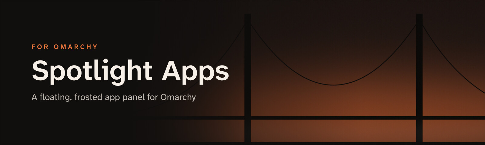

<p align="center">
  
</p>

<p align="center">
  <b>A floating, frosted, macOS Spotlight-style app panel for <a href="https://omarchy.org">Omarchy</a>.</b><br>
  Search as you type · browse by category · open Omarchy's settings · launch with Enter
</p>

<p align="center">
  
  
  
</p>

<p align="center">
  
</p>

## Get started

**1. Install the plugin**

```bash
omarchy plugin add https://github.com/JeoCrypto/omarchy-spotlight-apps --enable
```

**2. Give it a key** in `~/.config/hypr/bindings.lua` (`SUPER + A` is free in Omarchy's defaults):

```lua
o.bind("SUPER + A", "Spotlight Apps", "omarchy-shell shell toggle io.github.jeocrypto.launchpad")
```

**3. Frost the glass** (recommended) in `~/.config/hypr/looknfeel.lua`:

```lua
hl.layer_rule({ match = { namespace = "^launchpad$" }, blur = true, ignore_alpha = 0.2 })
```

## Highlights

<table>
  <tr>
    <td width="50%" valign="top">
      <h3>🔎 Search as you type</h3>
      Start typing the moment it opens. Apps match by name, generic name and keywords, so "calc" finds the calculator. Settings show up too.
    </td>
    <td width="50%" valign="top">
      <h3>🗂️ Browse by category</h3>
      All, Settings, Development, Office, Media, Internet, Games, System, Utilities and Web Apps, worked out from each app's desktop categories.
    </td>
  </tr>
  <tr>
    <td valign="top">
      <h3>⚙️ Omarchy settings, one tap away</h3>
      Coloured tiles open Omarchy's own panels and menus: Wi-Fi, Bluetooth, Sound, Display, Power, Theme, Background, Font, Keybindings, Monitors, Input, Setup and Updates.
    </td>
    <td valign="top">
      <h3>🪶 Light and sharp</h3>
      Loads only while it's open, so it uses no memory the rest of the time. Icons load at device resolution on HiDPI screens, and the colours follow your Omarchy theme.
    </td>
  </tr>
</table>

Your pinned apps sit in a suggested row above every app in alphabetical order. The row is shared with [Glass Dock](https://github.com/JeoCrypto/omarchy-glass-dock). Hidden apps match Omarchy's own Apps menu (`launcher.hides`).

## Keys

| Key | Action |
|---|---|
| Type | Search apps and settings |
| `←` `↑` `↓` `→` | Move the selection |
| `Enter` | Open the selected app or setting |
| `Tab` / `Shift+Tab` | Next / previous category |
| `Esc` | Clear the search, then return to All, then close |

Click an app to open it. Click outside the panel, or the × button, to close it.

## Configure

| File | What it does |
|---|---|
| `~/.config/glass-dock/pinned` | The suggested row: one desktop-file id per line (shared with Glass Dock). Without it, Files, Chromium and Foot are suggested. |

The Settings tiles, the categories and the sizes are defined at the top of `Launchpad.qml`.

**Open it from Glass Dock's app-grid button:**

```bash
mkdir -p ~/.config/glass-dock
echo "omarchy-shell shell toggle io.github.jeocrypto.launchpad" > ~/.config/glass-dock/launcher
```

## Update and remove

```bash
omarchy plugin update io.github.jeocrypto.launchpad
omarchy plugin remove io.github.jeocrypto.launchpad
```

After an update, run `omarchy restart shell` so the shell loads the new version. The plugin ID is `io.github.jeocrypto.launchpad`, its original name.

## Requirements

- Omarchy 4 (Hyprland 0.55+ with Lua config, Quickshell 0.3+)
- `uwsm` and `gtk-launch`, which Omarchy includes
- A Nerd Font for the settings glyphs (Omarchy's default monospace fonts include them)

---

<p align="center">
  <b>Part of the Golden Gate set for Omarchy</b><br>
  <a href="https://github.com/JeoCrypto/omarchy-golden-gate-theme">Golden Gate theme</a> ·
  <a href="https://github.com/JeoCrypto/omarchy-glass-dock">Glass Dock</a> ·
  <a href="https://github.com/JeoCrypto/omarchy-spotlight-apps">Spotlight Apps</a> ·
  <a href="https://github.com/JeoCrypto/omarchy-snap-layouts">Snap Layouts</a>
</p>

<p align="center"><sub>MIT licence</sub></p>
