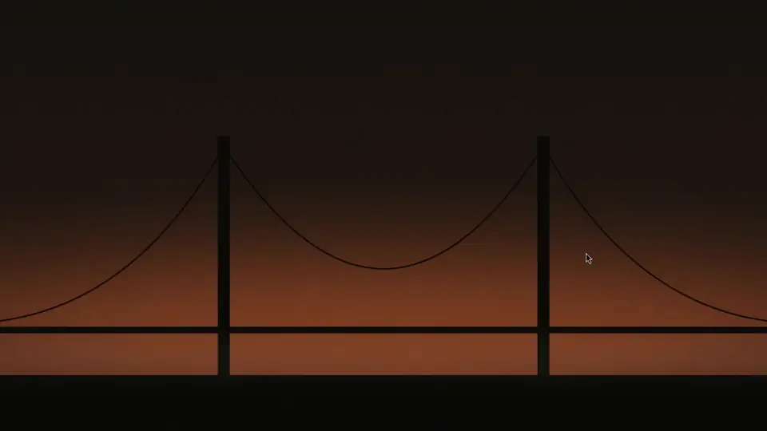

# Spotlight Apps

A floating, frosted, macOS Spotlight-style app panel for [Omarchy](https://omarchy.org), built as an Omarchy shell plugin.



- **A rounded glass card** with a soft shadow. Hyprland blurs only the area behind the card.
- **Search** as soon as it opens. Results include apps (by name, generic name and keywords) and settings.
- **Category chips:** All, Settings, Development, Office, Media, Internet, Games, System, Utilities and Web Apps, worked out from each app's desktop categories.
- **A suggested row** of your pinned apps, shared with [Glass Dock](https://github.com/JeoCrypto/omarchy-glass-dock), above every app in alphabetical order.
- **A Settings section** with coloured tiles that open Omarchy's own panels and menus: Wi-Fi, Bluetooth, Sound, Display, Power, Theme, Background, Font, Keybindings, Monitors, Input, Setup and Updates.
- **Sharp on HiDPI:** 56 px icons load at device resolution, and the settings tiles use vector glyphs.
- **Follows your Omarchy theme,** and hides the same apps as Omarchy's own Apps menu (`launcher.hides`).
- **Loads only while open,** so it uses no memory the rest of the time.

The plugin ID is `io.github.jeocrypto.launchpad` (its original name).

## Use

| Key | Action |
|---|---|
| Type | Search apps and settings |
| `←` `↑` `↓` `→` | Move the selection |
| `Enter` | Open the selected app or setting |
| `Tab` / `Shift+Tab` | Next / previous category |
| `Esc` | Clear the search, then return to All, then close |

Click an app to open it. Click outside the panel, or the × button, to close it.

## Install

```bash
omarchy plugin add https://github.com/JeoCrypto/omarchy-spotlight-apps --enable
```

### Keybinding

Add to `~/.config/hypr/bindings.lua` (`SUPER + A` is Ubuntu's "Show apps" shortcut and is free in Omarchy's defaults):

```lua
o.bind("SUPER + A", "Spotlight Apps", "omarchy-shell shell toggle io.github.jeocrypto.launchpad")
```

### Frosted blur (recommended)

Add to `~/.config/hypr/looknfeel.lua`:

```lua
hl.layer_rule({ match = { namespace = "^launchpad$" }, blur = true, ignore_alpha = 0.2 })
```

### Open it from Glass Dock (optional)

To make Glass Dock's app-grid button open Spotlight Apps:

```bash
mkdir -p ~/.config/glass-dock
echo "omarchy-shell shell toggle io.github.jeocrypto.launchpad" > ~/.config/glass-dock/launcher
```

### Update and remove

```bash
omarchy plugin update io.github.jeocrypto.launchpad
omarchy plugin remove io.github.jeocrypto.launchpad
```

After an update, run `omarchy restart shell` so the shell loads the new version.

## Configure

| File | What it does |
|---|---|
| `~/.config/glass-dock/pinned` | The suggested row: one desktop-file id per line (shared with Glass Dock). Without it, Files, Chromium and Foot are suggested. |

The Settings tiles, the categories and the sizes are defined at the top of `Launchpad.qml`.

## Requirements

- Omarchy 4 (Hyprland 0.55+ with Lua config, Quickshell 0.3+)
- `uwsm` and `gtk-launch`, which Omarchy includes
- A Nerd Font for the settings glyphs (Omarchy's default monospace fonts include them)

## License

MIT
